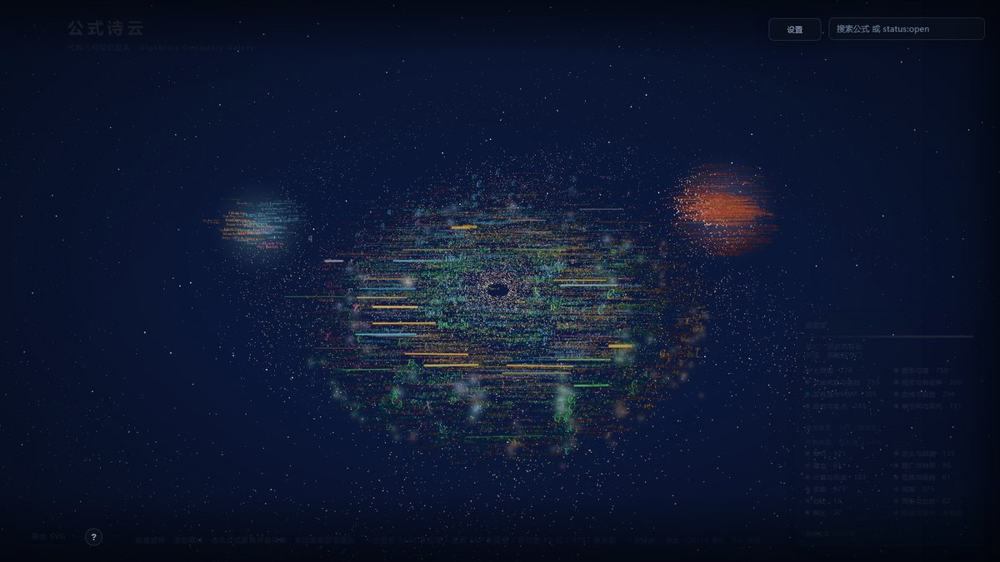
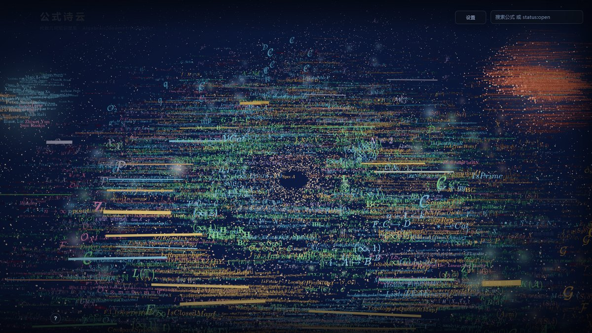
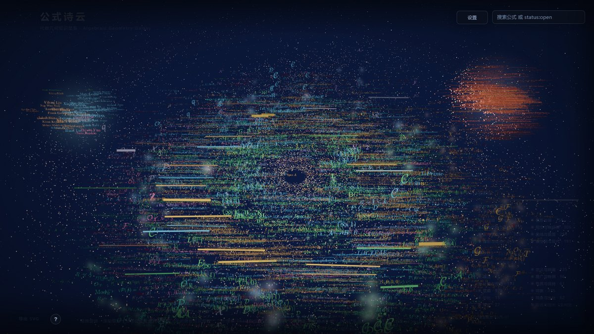
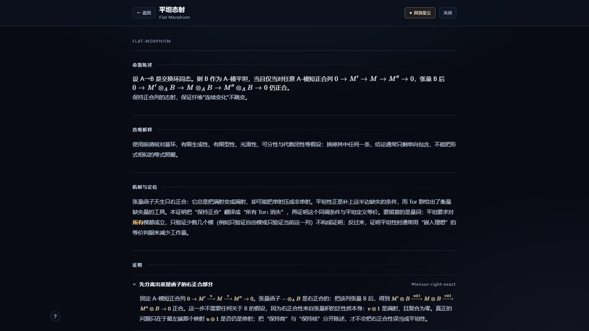
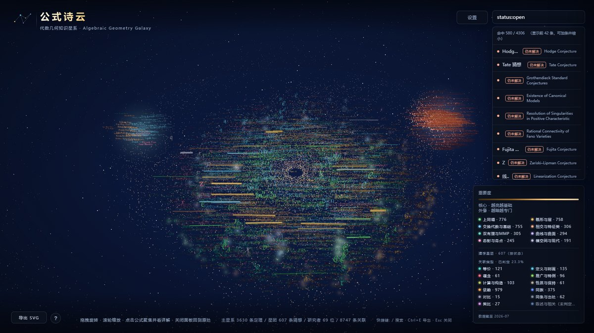

<div align="center">

# 公式诗云 · Formula Nebula

**把 4306 个代数几何公式与研究线索，铺成一片可以漫游的星云。**

3630 条定理 · 607 条猜想 · 69 位研究者 · 8747 条人工标注的关联

[](LICENSE-THIRD-PARTY.md)
[](https://nodejs.org/)
[](https://github.com/wenze-wu-math/Formula-Nebula/actions/workflows/ci.yml)
[](CONTRIBUTING.md)

### [🌌 在线体验 → wenze-wu-math.github.io/Formula-Nebula](https://wenze-wu-math.github.io/Formula-Nebula/)

[快速开始](#快速开始) · [它是什么](#它是什么) · [九种方案](#不止一个-3d-星云) · [参与贡献](CONTRIBUTING.md)

</div>

---

## 它是什么

数学知识通常是一个列表：定理 A 蕴含定理 B，猜想 C 至今未解。**读起来是行，想起来却不是。**

这个项目把它换成一个空间。定理按重要度落在一个扁盘上——越靠近核心越基础，越大越亮；未解决的猜想单独聚成一团球，越靠近球心越著名。它们之间用发光的线连着，每条线都注明了是什么关系：蕴含、等价、推广、还是仅仅同族。

你可以拖拽旋转，滚轮缩放，点开任意一个公式读它的完整证明。也可以直接搜、寻路：

```
霍奇猜想 -> 黎曼猜想        找出两者之间的关联链
status:open importance:>0.9  所有重要且未解决的猜想
```

灵感来自刘慈欣《诗云》：把一"堆"文字换成一"片"可以漫游的结构。

## 看看它长什么样



中间是主星系——3630 条定理按重要度从核心向外铺开，越靠内越基础、越大越亮。右侧橙红色的是**猜想星团**，越靠球心越著名。左侧是研究者网络。

<br>

| 飞近了看 | 环状形态 |
|---|---|
|  |  |
| 每个光点都是一个公式，连线上的文字说明了它们的关系 | 四种星系形态可即时切换 |

<br>

| 读证明 | 搜索与筛选 |
|---|---|
|  |  |
| 245 条定理有完整证明：陈述、直观解释、机制、分步推导、例子、推论 | `status:open` 筛出所有未解决的猜想 |

## 快速开始

```bash
git clone https://github.com/wenze-wu-math/Formula-Nebula.git
cd Formula-Nebula
npm install
npm run dev          # 打开 http://localhost:5175
```

首次加载需要预渲染公式贴图，**约 20–40 秒**（4306 个公式，进度条会显示）。之后就很快了。

<details>
<summary>没有 Node？或者想先看看它能跑吗</summary>

```bash
npm run ci           # 完整检查：数据完整性 + 67 项断言 + 412 项验证 + 构建 + 资源检查
```

约 15 秒。全绿说明这份代码在你这台机器上是健康的。

</details>

## 不止一个 3D 星云

同一份知识图谱，有 **9 种前端呈现方式**。它们不是效果图，每个都能实际打开：

| 方案 | 隐喻 | 说明 |
|---|---|---|
| **公式诗云** | 3D 星云 | 正式应用。星系盘 + 球状星团，漫游、搜索、寻路、读证明 |
| **公式大陆** | 城市地图 | 知识族是国家、定理是城市、关联是道路、猜想是海上岛屿（城市版） |
| **公式诗稿** | 书页 | 八章对应八族，铅笔线为关联，猜想写在页边批注（书页版） |
| **公式星图** | 古典星图 | 2D 星图：族是星座、定理是恒星（六等星等）、猜想是深空天体 |
| **历史时间线** | 时间轴 | 按 1800–2025 横排，可按年代区间缩放 |
| **论文浏览器** | 文献 | 按论文组织证明与引用，沿文献脉络阅读 |
| **可视化推荐** | AI | 按图结构推荐呈现方式并高亮关联子图 |
| **协作原型** | 工作流 | 提交 → 评审 → 反馈 → 版本迭代 |
| **分析面板** | 仪表盘 | 度分布、中心性、社区检测、证明完整度等 8 项指标 |

本地运行后打开 **`http://localhost:5190/designs/`** 可以看到全部方案的展览页。

> 这些方案需要由 Vite 提供（它们 `import 'three'` 等裸模块），所以用
> `npm run dev:designs` 启动，而不是直接双击 HTML 文件打开。
>
> **线上只部署主应用**（在线体验那个链接）。九个方案合计 24 MB，且依赖
> Vite 的模块解析，不适合放进静态托管产物 —— 想看它们请本地运行。

## 你能做什么

| | |
|---|---|
| **漫游** | 拖拽旋转、滚轮缩放、点击聚焦。`/` 搜索，`←` 返回上一个节点 |
| **搜索** | 支持字段查询：`status:open`、`family:scheme`、`importance:>0.9`，支持 `AND` / `OR` / `-` |
| **寻路** | `A -> B` 找出两个定理之间的最短关联链 |
| **读证明** | 点开任意定理看完整证明、历史、例子、推论。245 条有长篇证明 |
| **换形态** | 螺旋 / 棒旋 / 同心环 / 弥散盘，四种星系形态即时切换 |
| **换着色** | 按族、按状态、按领域、单色 |
| **导出** | `Ctrl+E` 导出当前视图为 SVG，或导出 LaTeX |

## 深链

任何状态都可以变成一条 URL，贴给别人就能打开同一处：

```
?p=flat-morphism              直接打开"平坦态射"的证明页
?n=zariski-topology           聚焦到某个节点
#v1&s=ring&c=family           切到环状 + 按族着色
```

## 技术栈

原生 ES modules + Three.js（WebGL）· KaTeX + MathJax 双渲染 · Vite 构建 · 无框架依赖

## 参与贡献

欢迎。先看 [CONTRIBUTING.md](CONTRIBUTING.md)，或者从 [good first issue](https://github.com/wenze-wu-math/Formula-Nebula/issues) 开始。

**最简单的贡献：补一条证明。** 160 个定理目前还没有详细的证明页，数据格式见 [docs/TECHNICAL-NOTES.md#怎么改内容](docs/TECHNICAL-NOTES.md)。

## 更多

| 想了解 | 去哪里 |
|---|---|
| 布局算法、渲染细节、六个踩过的坑 | [docs/TECHNICAL-NOTES.md](docs/TECHNICAL-NOTES.md) |
| 项目路线图 | [ROADMAP.md](ROADMAP.md) |
| 架构与目录结构 | [DIRECTORY_STRUCTURE.md](DIRECTORY_STRUCTURE.md) |
| 变更记录 | [CHANGELOG.md](CHANGELOG.md) |
| 如何持续改进这个项目 | [docs/EVOLUTION_LOOP.md](docs/EVOLUTION_LOOP.md) |
| 安全策略 | [SECURITY.md](SECURITY.md) |

## 致谢

布局与渲染的骨架参考了 [`Cohenjikan/shiyun`](https://github.com/Cohenjikan/shiyun)（旋涡星系骨架、指数盘半径分配、共用自转角）。**公式的 LaTeX 渲染、知识连线、"重要度同时驱动半径/大小/亮度"这三件事是该仓库没有的，为原创实现。**

证明内容整理自 Stacks Project、nLab、Wikipedia 等公开来源，逐条注明出处。

## 许可

MIT — 详见 [LICENSE-THIRD-PARTY.md](LICENSE-THIRD-PARTY.md)
